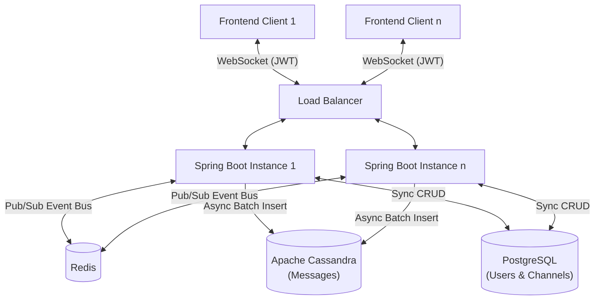
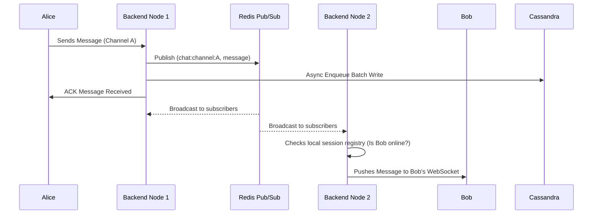
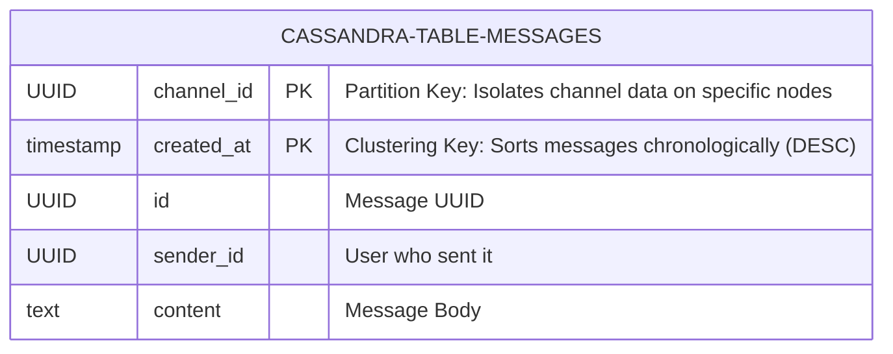

# Enterprise Chat Platform: System Design & Interview Guide

This document serves as the ultimate reference for the High-Performance Enterprise Chat Platform. It covers the system's architecture, how data flows between components, the engineering decisions made, the rejected alternatives, and how to discuss the system in an engineering interview.

---

## 1. System Overview & Scope

**Goal:** Build a horizontally scalable, real-time enterprise collaboration tool (similar to Slack or Microsoft Teams) capable of handling **10,000+ concurrent active connections** with extremely low message latency (sub-350ms p99).

**Scope:**
- Real-time text messaging across 1-on-1 and group channels.
- JWT-based authentication and secure session initialization.
- Asynchronous database persistence to handle massive throughput without blocking live chat.
- High-performance, custom-built load testing utility to continuously validate system limits.

### High-Level System Architecture



---

## 2. Component Architecture & Data Flow

### A. The Frontend (React/TypeScript)
- Uses WebSockets to maintain a persistent bi-directional connection.
- Communicates securely using a JWT token passed during the initial HTTP Upgrade request.

### B. The Backend (Java 21 + Spring Boot 3)
The backend is completely stateless, meaning you can run 1 or 100 instances of this application without them needing to share memory.
- **WebSocket Handlers (`ChatWebSocketHandler`)**: Manages the lifecycle of connections. When a message arrives, it is parsed and processed.
- **Session Registry**: A local thread-safe map (`ConcurrentHashMap`) that tracks which users are connected to *this specific node* and which channels they are looking at.

### C. The Real-Time Backplane (Redis Pub/Sub)
- **Why it exists**: If User A connects to Node 1 and User B connects to Node 2, Node 1 cannot send a message directly to Node 2's RAM. 
- **How it works**: Every time a user sends a message, the node publishes it to a Redis channel (e.g., `chat:channel:<ID>`). **All** backend nodes listen to Redis. When Node 2 receives the Redis message, it checks its local `SessionRegistry` to see if User B is online. If yes, it pushes the message down User B's WebSocket.

#### Message Delivery Sequence Diagram



### D. The Storage Layer (PostgreSQL + Apache Cassandra)
- **PostgreSQL**: Stores relational, highly-consistent data like Users, Channels, and Channel Memberships.
- **Apache Cassandra**: Stores the high-velocity chat messages.
- **Batch Writer (`MessageBatchWriter`)**: Instead of writing to the database synchronously on the main thread, messages are dropped into an in-memory queue. A background thread flushes them to Cassandra in batches of 50 every 100ms.

---

## 3. Key Architectural Decisions (The "Why")

### Decision 1: Moving Messages from PostgreSQL to Apache Cassandra
* **The Problem:** In a relational DB like Postgres, inserting thousands of messages per second into a single B-Tree index causes massive lock contention and slows down the whole system.
* **The Solution:** Migrated to Apache Cassandra (a Wide-Column NoSQL DB).
* **The Trade-offs & Alternatives:**
  * *Alternative:* Shard the PostgreSQL database. *Rejected because* managing application-level sharding is incredibly complex compared to Cassandra's native partitioning.
  * *Alternative:* MongoDB. *Rejected because* MongoDB is document-based and not specifically optimized for the append-only, high-write throughput that time-series data (like chat) generates.
  * *Why Cassandra?* Cassandra writes to an append-only commit log in memory (Memtable) and flushes to disk (SSTable) sequentially. Writes are basically $O(1)$. We partitioned the data by `channel_id` and clustered by `created_at DESC`. This means fetching a channel's history is incredibly fast because it's stored contiguously on disk.

#### Cassandra Data Model



### Decision 2: Using Redis Pub/Sub vs. Kafka/RabbitMQ
* **The Problem:** We needed a way for backend nodes to communicate instantly.
* **The Solution:** Redis Pub/Sub.
* **The Trade-offs & Alternatives:**
  * *Alternative:* Apache Kafka. *Rejected because* Kafka is designed for persistent, replayable event streaming. In a live chat application, if a node crashes, we don't want it to wake up and replay thousands of old messages to a client. Redis Pub/Sub is "fire-and-forget", which is perfect for volatile, real-time routing. (The DB handles the actual persistence).

### Decision 3: Java 21 Virtual Threads vs. WebFlux (Reactive Programming)
* **The Problem:** 10,000 active WebSockets require 10,000 threads. In traditional Java, OS-level threads use ~1MB of RAM each. 10k threads = 10GB of RAM just for idle connections, leading to out-of-memory crashes.
* **The Solution:** Java 21 Virtual Threads (Project Loom).
* **The Trade-offs & Alternatives:**
  * *Alternative:* Spring WebFlux (Reactive/Non-blocking). *Rejected because* reactive programming forces you to write complex, hard-to-read callback chains (e.g., `Mono` and `Flux`).
  * *Why Virtual Threads?* Virtual threads are managed by the JVM, not the OS. They consume bytes of memory, not Megabytes. We can write standard, easy-to-read synchronous code, but the JVM automatically unmounts the thread during blocking I/O (like a DB call), achieving the exact same scale as WebFlux without the cognitive overhead.

### Decision 4: The O(N²) Global Presence Bug Fix
* **The Story:** During load testing, the system crashed with 10,000 users, generating over 28 million messages on the network.
* **The Problem:** A naive implementation was broadcasting "User X connected" to *every single online user*. If 10,000 users connect, it results in $10,000 \times 10,000 / 2 = 50,000,000$ messages.
* **The Solution:** Disabled global real-time presence broadcasting. 
* **The Takeaway:** In high-scale systems, global broadcasts are anti-patterns. Presence should be lazy-loaded, batched, or restricted strictly to users who share a channel/friends list.

---

## 4. Future Expansion & Scope (What's Next?)

If an interviewer asks, "How would you improve this system?", here is your roadmap:

1. **Read Receipts & Delivery Acknowledgements:**
   - **How:** Add a Cassandra table tracking `last_read_message_id` per user per channel. When a user opens a channel, push a watermark update to the DB.
2. **Push Notifications (Offline Users):**
   - **How:** Integrate Firebase Cloud Messaging (FCM) or Apple Push Notification Service (APNs). If a message is sent to a user and the Redis lookup shows they have no active WebSocket sessions, publish an event to an AWS SQS queue where a worker service dispatches a mobile push notification.
3. **Media & File Attachments:**
   - **How:** Do not pass binary data through WebSockets. Implement an S3 presigned-url flow. The client requests a secure upload URL via a REST endpoint, uploads the image directly to AWS S3, and then sends the image URL via the WebSocket message payload.
4. **End-to-End Encryption (E2EE):**
   - **How:** Implement the Signal Protocol. The backend never sees the plaintext. It only stores the encrypted ciphertext and routes it. Public keys would be stored in PostgreSQL.
5. **Caching Layer for Channel History:**
   - **How:** Add a Redis Sorted Set (ZSET) to cache the last 100 messages of active channels to reduce read load on Cassandra during startup spikes.

---

## 5. Interview Cheat Sheet

* **What was your biggest technical challenge?**
  *"The biggest challenge was debugging a catastrophic network saturation issue under 10k user load. I discovered we had an $O(N^2)$ algorithmic bug in our presence system where global 'user joined' events were being broadcasted to all active connections, resulting in a 28-million message storm. Removing the global broadcast and migrating our data layer to Cassandra stabilized our p99 latency to under 350ms."*
  
* **Why did you use Cassandra?**
  *"Because chat applications are incredibly write-heavy (90% writes, 10% reads). Relational databases like Postgres suffer from B-Tree index lock contention during massive concurrent inserts. Cassandra's LSM tree architecture allows for $O(1)$ append-only writes, making it vastly superior for time-series chat data."*

* **How did you test it?**
  *"I couldn't rely on standard tools like JMeter because WebSockets require maintaining stateful, asynchronous connections. So, I wrote a custom load tester using Netty and Java Virtual Threads that simulated a realistic distribution curve of 10,000 users talking across personal and group channels."*

```mermaid
sequenceDiagram
    autonumber

    participant Alice as Alice Client
    participant LB as Load Balancer
    participant Node1 as Backend Node 1
    participant Redis as Redis Connection Registry
    participant Node3 as Backend Node 3
    participant Bob as Bob Client
    participant Cassandra as Cassandra

    Note over Bob,Node3: Bob establishes WebSocket connection

    Bob->>LB: WebSocket CONNECT + JWT
    LB->>Node3: Route WebSocket connection
    Node3->>Node3: Validate JWT
    Node3->>Node3: Generate connectionId
    Node3->>Node3: Store connectionId → WebSocketSession

    Node3->>Redis: Register Bob → {Node3, connectionId}
    Redis-->>Node3: Registration successful
    Node3-->>Bob: WebSocket CONNECTED

    Note over Alice,Bob: Alice sends message to Bob

    Alice->>LB: WebSocket: Send message
    LB->>Node1: Forward message

    Node1->>Redis: Lookup Bob's connections
    Redis-->>Node1: {Node3, connectionId}

    Node1->>Node3: gRPC DeliverMessage(connectionId, message)

    Node3->>Node3: Lookup connectionId in local SessionRegistry
    Node3->>Bob: WebSocket: Deliver message

    Node1->>Node1: Enqueue message
    Node1->>Cassandra: Async batch write
    Cassandra-->>Node1: Persisted

sequenceDiagram
    autonumber

    participant Alice as Alice Client
    participant Node1 as Backend Node 1
    participant Redis as Redis Connection Registry
    participant Cassandra as Cassandra
    participant Queue as Notification Queue
    participant Push as Push Service
    participant Bob as Bob Client
    participant Node3 as Backend Node 3

    Alice->>Node1: Send message to Bob

    Node1->>Cassandra: Persist message
    Cassandra-->>Node1: Message persisted

    Node1->>Redis: Lookup Bob's active connections
    Redis-->>Node1: No active connection

    Node1->>Queue: Publish offline notification event
    Queue->>Push: Process notification
    Push-->>Bob: Push notification

    Note over Bob: Bob is offline

    Bob->>Node3: WebSocket CONNECT + JWT
    Node3->>Redis: Register Bob → {Node3, connectionId}
    Redis-->>Node3: Registration successful

    Node3->>Cassandra: Fetch messages since lastReadMessageId
    Cassandra-->>Node3: Missed messages

    Node3->>Bob: Deliver missed messages
